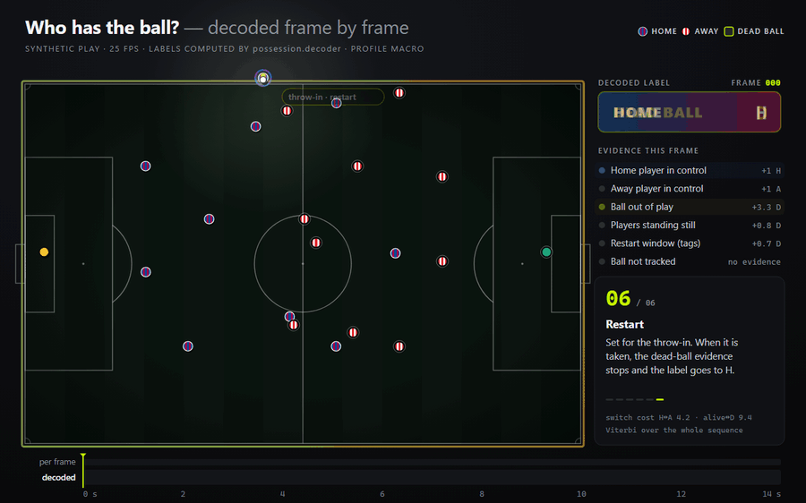

<p align="center">
  <a href="https://theshrewdies.com"></a>
</p>

<p align="center">
  <a href="https://theshrewdies.com"></a>
  <a href="report/the-shrewdies-technical-report.pdf"></a>
  <a href="https://github.com/Shrewdies/MTAH2027"></a>
  
</p>

<p align="center">
  <picture>
    <source type="image/svg+xml" srcset="assets/hero/hero.svg">
    
  </picture>
</p>

# Who has the ball? — Initial Challenge · More Than a Hack 2027

Every frame of a 133-minute match video labelled **H** (home in possession), **A** (away in possession)
or **D** (ball dead), from automatic tracking and tactical tags, with no training on the match.

**How it works.** Football evidence is measured on every frame — who is close enough to control
the ball, whether it left the pitch, whether play has stopped — and an exact dynamic program
(Viterbi) picks the single most coherent possession story for each half. A ball the tracker cannot
see is treated as *no evidence*, so possession stays with the team that last controlled it. Tag
codes are weighted automatically by how well they agree with visible ball control. The decoder's
parameters come from a Pareto front of the two official metrics, and the submitted profile was
chosen on an openly labelled Bundesliga match.

| on a labelled external match (ball hidden on 41% of frames, as in the competition) | spellF1 | macroF1 |
|---|---|---|
| organisers' baseline method | 0.235 | 0.383 |
| **this pipeline** | **0.340** | **0.693** |

Full reasoning, trials and limitations: **[technical report](TECHNICAL.md)**
([PDF](report/the-shrewdies-technical-report.pdf) · [slides](report/the-shrewdies-technical-report.pptx)) ·
the organisers' original README: [OFFICIAL_README.md](OFFICIAL_README.md)

| | in the report |
|---|---|
| How the parameters were chosen | [§6 the Pareto decision log](TECHNICAL.md#6-choosing-the-parameters-the-pareto-decision-log) |
| How the result is reproducible | [§8 reproducibility](TECHNICAL.md#8-reproducibility-how-it-is-ensured) |
| How the data was protected | [§9 data privacy and security](TECHNICAL.md#9-data-privacy-and-security-considered-at-every-step) |

## Beyond this repository

The reasoning behind the code lives in our knowledge hub, **[theshrewdies.com](https://theshrewdies.com)**:

| | |
|---|---|
| [Datasets](https://theshrewdies.com/datasets/) | an atlas of football datasets and what each can teach a possession model |
| [Solutions](https://theshrewdies.com/solutions/) | the landscape of models, methods and tools for football intelligence, mapped and judged |
| [Architecture](https://theshrewdies.com/architecture/) | our DNA in architecting football intelligence: the design space, the calls we made in it, and [the single source of truth](https://theshrewdies.com/architecture/single-source-of-truth/) |
| [Challenges](https://theshrewdies.com/challenges/) | how we read the problem, and [what comes next](https://theshrewdies.com/challenges/roadmap/) |
| [On-device](https://theshrewdies.com/on-device/) | data protection, reproducibility and the hardware we compute on |
| [Team](https://theshrewdies.com/team/) | the four Shrewdies |

## Reproduce

Only Docker is required. The image is multi-arch (linux/arm64 and linux/amd64), Python 3.11 with
pinned numpy and pandas; source and data are mounted read-only at run time and the container has
no network. The match data is not in this repository (it is not redistributable).

`DATA` below is the folder that contains `tactical/BAR-ATH_tactical_atd.txt` ([DATA.md](DATA.md)).

**Linux / macOS**

```bash
scripts/run.sh build                 # ~30 s
scripts/run.sh test                  # 15 tests, no data needed
scripts/run.sh submit "$DATA" outputs
```

**Windows (PowerShell)**

```powershell
.\scripts\build.ps1
.\scripts\test.ps1
.\scripts\run_protected.ps1 -DataDir "$DATA" -OutDir outputs -Name submission
```

**Plain Docker (any OS)**

```bash
docker build -t mtah2027:dev .
docker run --rm --network none --read-only --tmpfs /tmp -e MTAH_DATA_DIR=/data \
  -v "$PWD:/work:ro" -v "$DATA:/data:ro" -v "$PWD/outputs:/out" mtah2027:dev \
  sh -c "python -m possession.run --out /out/submission.csv && \
         python evaluation/validate_submission.py /out/submission.csv"
```

The run takes under 10 seconds and writes byte-identical output every time. It reads only the
tactical tracking and the Smart Tagging, never a ground truth. `--profile balanced|spell|reasoned`
selects the other frozen parameter profiles.

**Offline builds.** `scripts/fetch_wheels.sh` (or `.ps1`) downloads the pinned wheels into
`wheels/`; when they are present the build installs from them without network access.

### Optional

```bash
# Regenerate the parameter profiles (simulated matches, ~15 s)
docker run --rm --network none -v "$PWD:/work" mtah2027:dev \
  python -m possession.pareto --samples 64 --generations 3 --halves 6 --workers 10

# External validation on open DFL data (CC-BY 4.0, figshare 10.6084/m9.figshare.28196177)
docker run --rm --network none -v "$PWD:/work:ro" -v "$DFL:/ext:ro" mtah2027:dev \
  python -m possession.external_dfl --positions /ext/<positions>.xml --info /ext/<matchinformation>.xml
```

## Layout

| path | |
|---|---|
| `possession/inputs.py` | tracking and Smart Tagging readers |
| `possession/decoder.py` | evidence, tag calibration, Viterbi, diagnostics |
| `possession/params.py`, `profiles.json` | parameters and the frozen profiles (`macro` submitted) |
| `possession/simulate.py`, `pareto.py` | simulator and two-objective search behind the profiles |
| `possession/external_dfl.py` | validation on a labelled external match |
| `possession/run.py` | regenerates the submission |
| `possession/tests/` | behaviour tests and the official validator |
| `evaluation/`, `starter/`, `games.py` | the organisers' scorer and tooling, unchanged |
| `report/`, `TECHNICAL.md` | technical report (PDF, slides, source) |

## Licence

Built on the organisers' repository (MIT, see [LICENSE](LICENSE); the licence does not cover the
match data). Our additions are released under the same MIT licence. DFL data: © DFL Deutsche
Fußball Liga, CC-BY 4.0, Bassek et al. (2025), *Scientific Data* 12:195.
